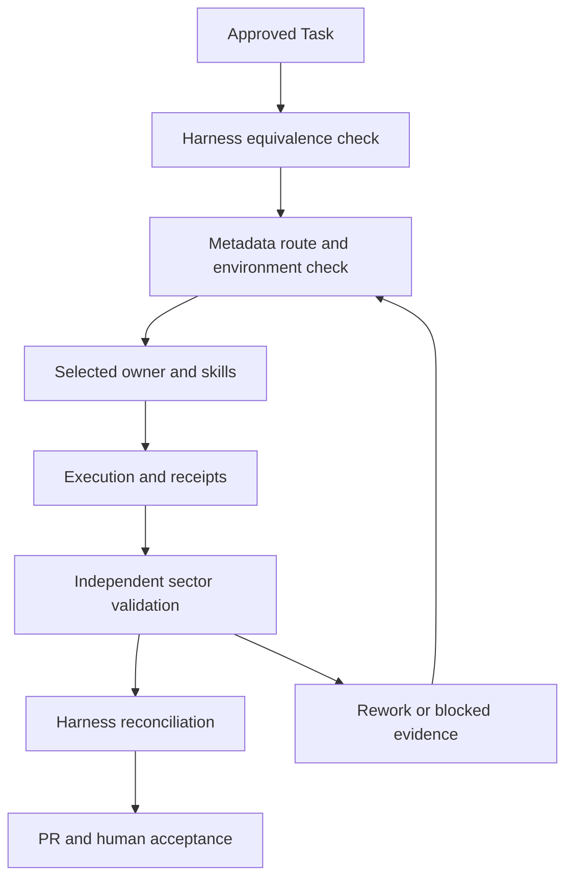

# Execution and recovery

For COMPLEX work use approved PRD, architecture and SDD. NORMAL work uses a focused spec when needed. TRIVIAL work follows preserved minimal-change rules; it must not trigger full discovery or unrelated agents. Mandatory validation remains proportional to the changed surface, never waived for token savings.

On resume compare Task ID, contract revision, source/artifact changes and dependency receipt scope. Reuse evidence only after freshness/applicability check; stale results return the affected owner to validation. A scope change updates Human Task and equivalent JSON before affected execution. Keep PENDING, READY, RUNNING, VALIDATING, REWORK, BLOCKED and COMPLETED from V1. No new competing task state machine is introduced.

The source-derived skill mapping and all section hashes live in migration evidence. Loading a capability means reading its full SKILL.md plus its mandatory core and selected references, not summarizing away safeguards.
