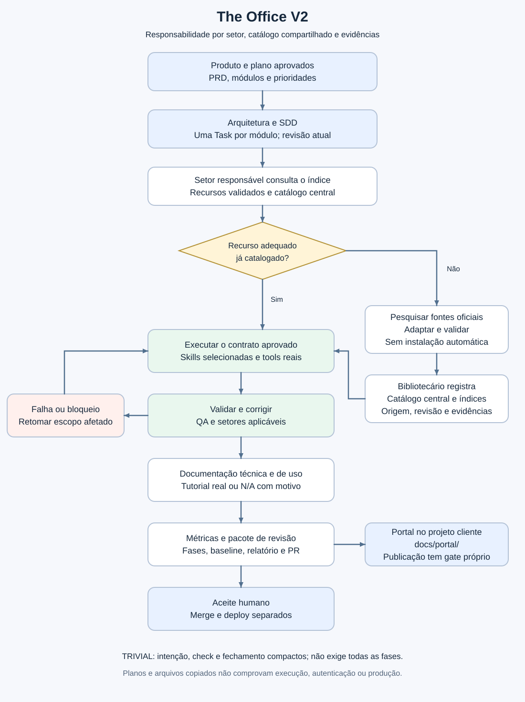

# Como o The Office V2 foi construído

## Base e composição

A migração parte do Dev-workflow `af94e8022eaec3e4eedfb4a2a62e13c6b349b9c4`.
Mantém 342 arquivos congelados e os 12 plugins originais. Em vez de reescrever
motores, acrescenta contratos de responsabilidade, skills funcionais derivadas,
índices compartilhados e helpers determinísticos. A branch é versão alpha para
aceitação; homologação em host/plataforma exige execução real.

| Componente | Implementação e contrato |
| --- | --- |
| Entrada | AGENTS.md aplica política V2, complexidade, escopo e gates |
| Responsabilidade | agents/*/AGENT.md define quem entrega e valida cada resultado |
| Skills | skills/*/SKILL.md, com core necessário e procedimento selecionado |
| Migração | scripts/build_skill_routes.py mantém seções e hashes V1 → V2 |
| Catálogo | scripts/build_library.py indexa metadados; resources.json é cache derivado |
| Roteamento | scripts/office.py gera planos, consulta/recupera fontes e prepara handoffs |
| Governança | Issue = Human Task, JSON v2 equivalente, evidências fora do contrato |
| Ambiente | Environment e tool-state originais; overlays por plataforma |
| Engenharia reversa | REA original e gateway preservados; nenhuma reconstrução por prompt |
| Documentação | documentation-core + templates Diátaxis e evidência do software real |
| Progresso | delivery-metrics e delivery_report.py, snapshot derivado sem nova Task truth |
| Portal | Origem externa versionada, preparada em docs/portal/ do cliente |

Os helpers próprios usam Python/stdlib; REA, SEO e ferramentas externas mantêm
seus runtimes/contratos. Node, Docker, banco e Redis não formam uma infraestrutura
obrigatória do Harness. Host de IA e SO são eixos diferentes; WSL é runtime Linux.

## Fluxo e fronteiras

Produto, Arquitetura/SDD e setores usam o mesmo contrato. O setor consulta o
catálogo por metadados; uma lacuna dispara pesquisa pontual e validação, seguida
de registro central. O resultado segue para execução/QA, documentação e relato.
Bloqueio ou rework retorna somente ao escopo afetado, sem reiniciar o Discovery.
[Contratos setoriais](agents.md) e [lifecycle](../operations/delivery-lifecycle.md).

## Trade-offs principais

| Decisão | Benefício | Custo/limite |
| --- | --- | --- |
| Overlay compatível sobre V1 | Preserva ferramentas, caminhos, regras e testes | Mantém estrutura antiga e referências-base explícitas |
| Slices com hashes/seções exatas | Rastreia regras sem resumir destrutivamente | Texto preservado não prova equivalência comportamental de toda LLM |
| Contratos setoriais e skills sob demanda | Responsabilidade clara e menor leitura irrelevante | Depende de seleção e leitura reais pelo host |
| Um catálogo, índices por setor | Evita duplicação e pesquisa repetida | Precisa invalidar cache quando a origem muda |
| TRIVIAL inline | Reduz cerimônia de baixo impacto | Exige classificar risco corretamente; bugs/UI não são automaticamente triviais |
| Reuso de runtimes/CLIs maduros | Menos código próprio e maior compatibilidade | Plataformas, versões, auth e serviços externos precisam de verificação |
| Documentação versionada única | Manual/help podem consumir a mesma fonte | Renderer, capturas e sincronização precisam de validação do produto |
| Métrica por critérios de escopo | Fórmula explícita incluindo trabalho não iniciado | Não mede tempo/esforço; cobertura e aceite precisam de revisão semântica |
| Portal separado do Harness | Cada cliente mantém docs/configuração próprios | API/OAuth/deploy não vêm prontos só com cópia; total atual difere da nova métrica |
| README atual + histórico recolhido | Navegação clara preservando anchors/testes legados | Arquivo continua grande; ler só tópicos atuais salvo investigação histórica |

Os trade-offs são decisões locais, não recomendações universais atribuídas a um
fornecedor. ADRs 001–005 registram os limites efetivos. Não criar microsserviços,
containers ou agentes persistentes apenas para espelhar estes setores.

## Contratos, evidência e falhas

Os dez IDs setoriais do JSON v2 continuam canônicos. Responsáveis lógicos podem
compartilhar executor; `delivery-metrics` pertence à Governança/orquestrador e não
cria outro campo setorial. Handoff transfere Task/revisão/setor/lista/objetivo/
fontes/recibos/próxima ação. Um plano não autoriza execução nem prova outro agente.

Mudança material exige revisão equivalente Issue/JSON. Estado de execução fica
nos comentários/receipts. Recuperação verifica frescor e repete só validação
afetada. Falta de referência obrigatória bloqueia a afirmação; ferramenta opcional
pode ter fallback compatível, com limitação explícita.

## Testes e limites

A suite preservada e os testes V2 verificam estrutura, rotas, contratos, fontes,
ambiente, falhas e helpers. O calculador também testa bloqueios, documentação,
hashes, escapes, pesos e exportação mínima. Plop é executado apenas quando seu
runtime de teste é fornecido. Evidência detalhada está nos relatórios de migração.

O ensaio do Portal executa o sincronizador original em checkout temporário; não
valida cliente, backend ou identidade. Somente testes reais do produto confirmam
comportamento/UI. Nem texto preservado nem testes de empacotamento comprovam
modelo autônomo correto, economia de tokens ou suporte nativo universal.
